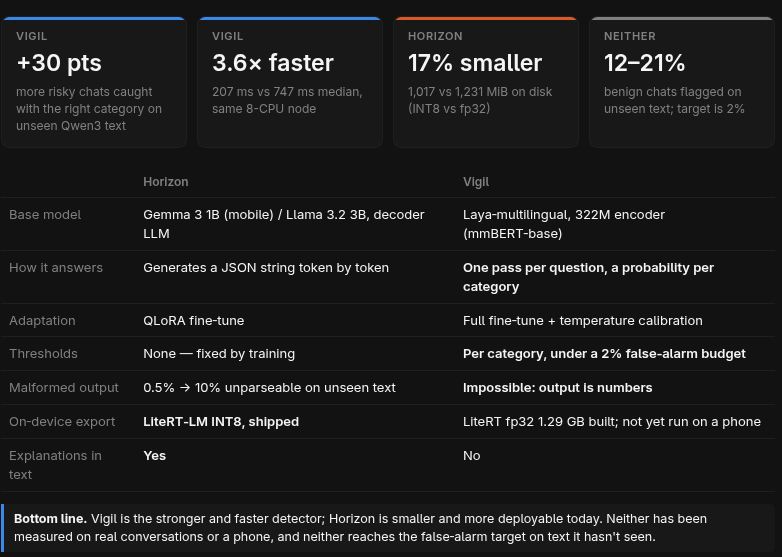
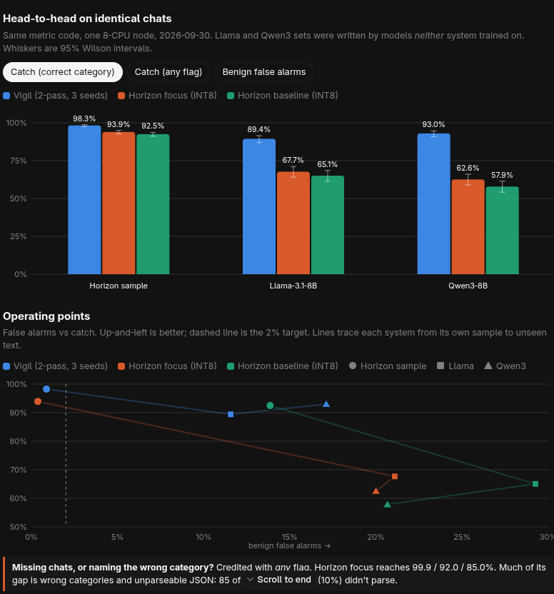

<div align="center">


# Vigil

**A small, fast child-safety risk classifier for chats.**
One forward pass reads a conversation and returns typed scores for seven risk categories plus severity.

[Model on Hugging Face](https://huggingface.co/safecircleai/vigil) · [Comparison report](docs/vigil-vs-horizon.pdf) · [Results log](docs/results) · [Releases](https://github.com/safecircleia/vigil/releases)

</div>

<p align="center">
  
  
  
  
  
  
  
</p>

---

## What it does

Given a chat between a child and someone else, Vigil answers: **which risks does it show, and how severe is it?**

| Categories | Severity |
|---|---|
| `grooming` · `bullying` · `sexual_content` · `isolation` · `personal_info` · `platform_migration` · `threats` | `none` · `low` · `medium` · `high` · `critical` |

Vigil is a full fine-tune of [Laya-multilingual](https://huggingface.co/convaiinnovations/laya-multilingual) (322M encoder, English and Spanish tested). Unlike a generative model, it does not write JSON: each question is answered by a single encoder pass, so output is typed, calibrated, and cheap.

- **Fast.** About 11 ms per conversation on GPU (2-pass design) and about 207 ms on an 8-CPU node.
- **Typed output.** Per-category probability, severity, and confidence, each with its own threshold chosen on validation data under a benign false-alarm budget.
- **On-device ready.** Exports to ONNX and LiteRT (`.tflite`) for the SafeCircle Android app.

<p align="center">
  
  
</p>

## Honest status

Read this before relying on any number.

- Vigil is **research**. It has **not been run on a phone**; the `.tflite` was only run with the Python interpreter.
- All data is **LLM-written synthetic text**. Nothing here measures real-world performance.
- On text from generators it was not trained on, **Vigil still flags 12-21% of harmless chats** (target: 2%). The in-distribution numbers (about 98-100% catch rate, under 2% false alarms) are inflated by generator similarity; see [`xgen.md`](docs/results/xgen.md).
- Friendly teasing between friends is the weakest scene (about 50% flagged); a blind audit shows these are real model errors, not label noise ([`banter.md`](docs/results/banter.md)).

## Vigil vs Horizon

Horizon is SafeCircle's generative classifier (Gemma 3 1B / Llama 3.2 3B, QLoRA). Same chats, same metrics, same 8-CPU node:

| | Horizon (INT8) | Vigil (fp32) |
|---|---|---|
| Correct-category catch rate vs Horizon, unseen generators | baseline | **+21.7 and +30.4 pts** |
| Median CPU latency per chat | 747 ms | **207 ms (3.6x faster)** |
| Memory | 2,601 MiB | **2,018 MiB** |
| Disk | **1,017 MiB** | 1,231 MiB |
| Shipped on-device | **yes (LiteRT-LM)** | not yet |

Full write-up with intervals and an improvement plan: [`docs/vigil-vs-horizon.pdf`](docs/vigil-vs-horizon.pdf) ([html](docs/vigil-vs-horizon.html)).

## Install

```bash
git clone https://github.com/safecircleia/vigil && cd vigil
uv sync                    # or: pip install -e .
uv sync --extra export     # adds onnx / onnxruntime for exporting
```

Requires Python 3.11+. Training and evaluation expect a GPU; the repo's own runs used a SLURM cluster (`slurm/`).

## Pipeline

```text
fetch_data -> preprocess -> train -> evaluate (thresholds on validation) -> export
```

| Stage | Code |
|---|---|
| Dataset: [`safecircleai/horizon-training-data`](https://huggingface.co/datasets/safecircleai/horizon-training-data) | `vigil/fetch_data.py`, `vigil/preprocess.py` |
| Training (cross-entropy + RLCD term, `--seed`) | `vigil/train.py`, `slurm/train.sbatch` |
| Evaluation, calibration, greedy per-category thresholds | `vigil/evaluate.py`, `vigil/calibrate.py`, `vigil/metrics.py` |
| Cross-generator tests (unseen LLM-written chats) | `vigil/xgen.py`, `slurm/xgen.sbatch` |
| ONNX / LiteRT export and on-device assets | `scripts/export_onnx.py`, `scripts/export_litert.py`, `vigil/ondevice.py`, `vigil/bpe.py` |

### Pinned revisions

Every Hub download needs an explicit commit sha (or tag). `main` is refused.

- `fetch_data`: `--revision <dataset sha>` (`REVISION=` in `slurm/fetch_data.sbatch`).
- `preprocess` and `train`: `--base-revision <base model sha>` (`BASE_REVISION=` in the sbatch scripts). `train` writes `BASE_MODEL` (`repo@sha`) into its output directory.
- `evaluate`: a local checkpoint directory is validated (safetensors and JSON/text only, `encoder/` and `tokenizer/` required). A Hub id such as the zero-shot base needs `--revision` (`MODEL_REVISION=` in `slurm/evaluate.sbatch`).
- `scripts/export_*.py`: accept local validated checkpoint directories only.

Set `VIGIL_BASE_REVISION` to run the tests that download the base model.

Two question designs exist: **noul7** (7 yes/no questions + severity, 8 passes) and **choice8** (one 8-way choice + severity, 2 passes). choice8 is the one exported for mobile.

### Tests

```bash
uv run pytest                      # fast unit tests
uv run pytest -m "integration"     # needs the Laya checkpoint from the Hub
```

## On-device (Android)

`scripts/export_litert.py` and `scripts/export_ondevice_assets.py` produce three files for the app:

| File | Size | Role |
|---|---|---|
| `vigil_s512_fp32.tflite` | 1.29 GB | encoder + head, input `[2, 512]` |
| `vigil_spec.json` | 3 KB | question prefixes, marker positions, temperatures, thresholds |
| `vigil_tokenizer.bin` | 9 MB | compact BPE tokenizer (matches Hugging Face on 3,037/3,037 strings) |

fp32 is the one to ship: thresholds are tiny (0.004 to 0.12), so int8 drift flips decisions. Details in [`litert-export.md`](docs/results/litert-export.md).

## Research log

Every experiment is written up with setup, results, and caveats:

[pilot](docs/results/pilot.md) · [cross-generator](docs/results/xgen.md) · [mixed training](docs/results/mixed-training.md) · [false-alarm audit](docs/results/false-alarm-audit.md) · [FA budget](docs/results/fa-budget.md) · [rounds 2-4](docs/results/round2.md) · [seeds + hard negatives](docs/results/seeds-hardneg.md) · [banter](docs/results/banter.md) · [deploy calibration](docs/results/deploy-calibration.md) · [LiteRT export](docs/results/litert-export.md)

## Releases

Tagged releases are published on the [Releases page](https://github.com/safecircleia/vigil/releases) with the exported model assets attached. Weights and the model card live on [Hugging Face](https://huggingface.co/safecircleai/vigil).

## Intended use and limits

Vigil is a **triage signal** for parental-safety tooling, not a verdict. It must not be used alone to accuse, punish, or report anyone. Expect false alarms and misses, keep a human in the loop, and do not deploy without evaluating on conversations that resemble your own.

## License and credits

Vigil's code is released under the [Apache License 2.0](LICENSE).

Built on [Laya](https://github.com/NandhaKishorM/laya) (Apache 2.0); `scripts/export_onnx.py` is adapted from it (see [`NOTICE`](NOTICE)). Dataset and Horizon by SafeCircle.
